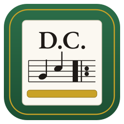

# Da Capo

**Get all your Finale scores out, faithfully and in bulk — to MusicXML and MuseScore.**
**Sortir toutes ses partitions de Finale, fidèlement et en lot — vers MusicXML et MuseScore.**

*Da capo*: “from the beginning”, in music. Windows · macOS · Linux · English / Français.

➡️ **[Download / Télécharger](https://github.com/ARP273-ROSE/DaCapo/releases/latest)** ·
[User guide (PDF)](docs/manuel-en.pdf) · [Manuel (PDF)](docs/manuel-fr.pdf) ·
[Changes / Historique](CHANGELOG.md)

| | Permanent download links / Liens de téléchargement permanents |
|---|---|
| Windows | [DaCapo-Setup.exe](https://github.com/ARP273-ROSE/DaCapo/releases/latest/download/DaCapo-Setup.exe) |
| macOS Apple Silicon | [DaCapo-macos-arm64.dmg](https://github.com/ARP273-ROSE/DaCapo/releases/latest/download/DaCapo-macos-arm64.dmg) |
| macOS Intel | [DaCapo-macos-x86_64.dmg](https://github.com/ARP273-ROSE/DaCapo/releases/latest/download/DaCapo-macos-x86_64.dmg) |
| Linux x86_64 | [DaCapo-linux-x86_64.tar.gz](https://github.com/ARP273-ROSE/DaCapo/releases/latest/download/DaCapo-linux-x86_64.tar.gz) |
| Linux ARM64 | [DaCapo-linux-arm64.tar.gz](https://github.com/ARP273-ROSE/DaCapo/releases/latest/download/DaCapo-linux-arm64.tar.gz) |

---

## English

Finale is no longer developed (2024). Its `.mus` / `.musx` files can only be read by Finale itself;
the way out is **MusicXML**, which MuseScore Studio (free), Dorico and Sibelius open. With hundreds
of scores, exporting them one by one is not an option: Da Capo does it for you.

1. **Finds** every Finale score in the chosen folders (subfolders included).
2. **Copies** each one into a working folder and checks the copy (SHA-256). Finale only ever opens
   the copies: **the originals are never opened or modified**.
3. **Drives Finale** (Windows): opens each copy, exports MusicXML and, optionally, a **reference PDF**
   (the score exactly as Finale prints it), closes without saving. It picks the **most recent Finale**
   installed — a recent Finale opens old `.mus` files and writes a much more faithful MusicXML.
4. **Checks** every MusicXML: parts, bars, notes, rests, lyrics, dynamics. An empty or truncated
   export is flagged.
5. **Prepares MuseScore** files (`.mscz`) with a PDF, to compare page by page with the reference PDF.
6. Writes **`rapport.html`**: failures first, then what deserves a look, then the rest.

Robust over hours: progress is saved after every score, an interrupted run **resumes** where it
stopped, an unexpected Finale message is recorded and dismissed, a hung Finale is restarted, and the
computer is kept awake. Menus are recognised by their labels in English and French, for Finale 2003
to 27. A **Diagnostics** button records Finale's menus and windows to adapt Da Capo to an unknown
version.

On macOS and Linux, Finale cannot be driven: Da Capo copies, checks MusicXML files exported
elsewhere and prepares the MuseScore files.

## Français

Finale n'est plus développé (2024). Ses fichiers `.mus` / `.musx` ne s'ouvrent que dans Finale ; la
sortie, c'est le **MusicXML**, que lisent MuseScore Studio (gratuit), Dorico et Sibelius. Avec des
centaines de partitions, les exporter une à une n'est pas envisageable : Da Capo le fait pour vous.

1. **Trouve** toutes les partitions Finale des dossiers choisis (sous-dossiers compris).
2. **Copie** chacune dans un dossier de travail et vérifie la copie (SHA-256). Finale n'ouvre que les
   copies : **les originaux ne sont jamais ouverts ni modifiés**.
3. **Pilote Finale** (Windows) : ouvre chaque copie, exporte le MusicXML et, au choix, un **PDF de
   référence** (la partition exactement comme Finale l'imprime), referme sans enregistrer. Il prend le
   **Finale le plus récent** installé : un Finale récent ouvre les anciens `.mus` et écrit un MusicXML
   bien plus fidèle.
4. **Vérifie** chaque MusicXML : parties, mesures, notes, silences, paroles, nuances. Un export vide
   ou tronqué est signalé.
5. **Prépare les fichiers MuseScore** (`.mscz`) avec un PDF, à comparer page à page au PDF de référence.
6. Rédige **`rapport.html`** : d'abord les échecs, puis ce qui mérite un coup d'œil, puis le reste.

Solide sur des heures : l'avancement est enregistré après chaque partition, un export interrompu
**reprend** là où il s'était arrêté, un message imprévu de Finale est consigné puis refermé, un Finale
figé est relancé, et l'ordinateur ne se met pas en veille. Les menus sont reconnus par leurs libellés,
en français et en anglais, de Finale 2003 à 27. Un bouton **Diagnostic** relève les menus et les
fenêtres de Finale pour adapter Da Capo à une version inconnue.

Sous macOS et Linux, Finale ne peut pas être piloté : Da Capo copie, vérifie les MusicXML exportés
ailleurs et prépare les fichiers MuseScore.

---

Finale is a trademark of MakeMusic, MuseScore of Muse Group; Da Capo is affiliated with neither.
Finale est une marque de MakeMusic, MuseScore de Muse Group ; Da Capo n'est lié à aucun des deux.
